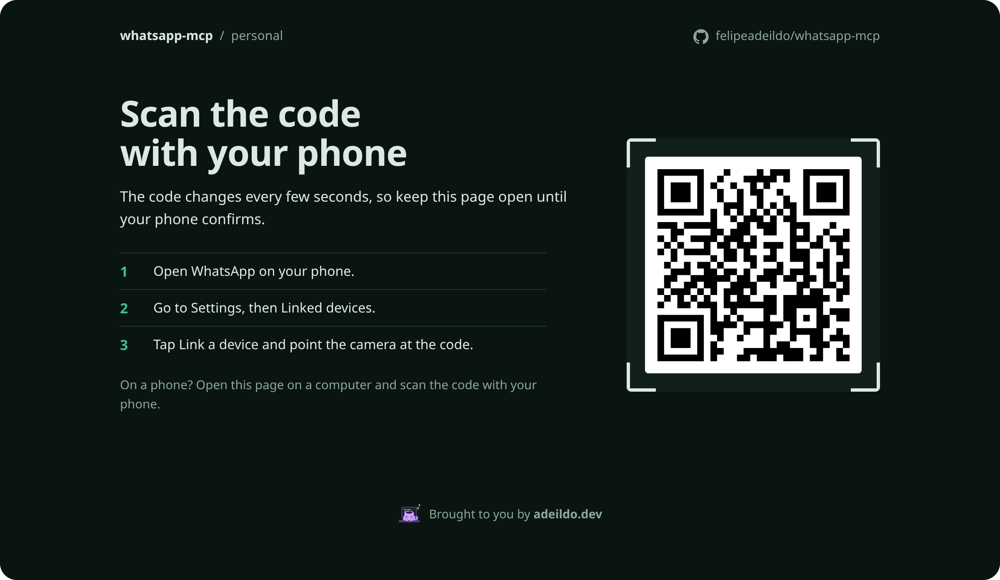
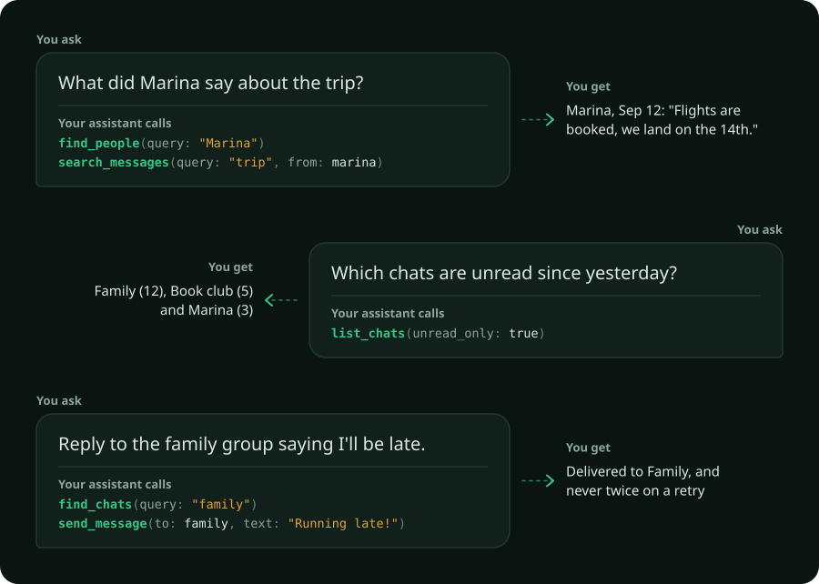
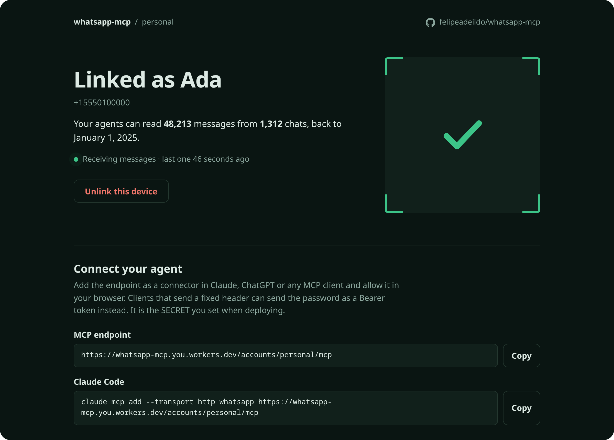
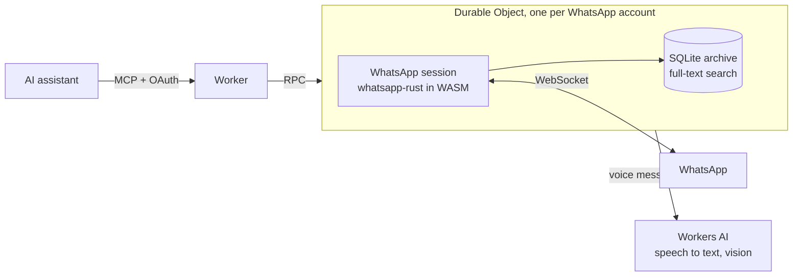

<div align="center">

# whatsapp-mcp

**Give your AI agents your WhatsApp.**

[](https://modelcontextprotocol.io) [](https://developers.cloudflare.com/durable-objects/) [](LICENSE)

[](https://deploy.workers.cloudflare.com/?url=https://github.com/felipeadeildo/whatsapp-mcp)

<br>



</div>

whatsapp-mcp lets an AI assistant like Claude read, search and send your WhatsApp messages. It links to your account as a device, the way [WhatsApp Web](https://faq.whatsapp.com/1317564962315842) does, and keeps a searchable archive of your chats in your own [Cloudflare](https://www.cloudflare.com) account. It speaks [MCP](https://modelcontextprotocol.io/introduction), so it works with Claude, ChatGPT, Claude Code, Cursor and other MCP clients.

<div align="center">

</div>

## Get started

You need a [Cloudflare account](https://dash.cloudflare.com/sign-up) on Workers Paid, a [GitHub account](https://github.com/signup) and your phone.

1. Click **Deploy to Cloudflare** above. Cloudflare copies this project to your GitHub and puts it online at `https://whatsapp-mcp.<your-name>.workers.dev`. When it asks for `SECRET`, give it a password of at least 16 characters, like the output of `openssl rand -hex 32`. Anyone who has it can read and send your messages.
2. Open `https://whatsapp-mcp.<your-name>.workers.dev/accounts/personal`, sign in with `SECRET` and select **Link WhatsApp**. On your phone, go to **Settings → Linked devices → Link a device** and scan the code. `personal` is a name you choose, and each name is a separate WhatsApp account.
3. Add `https://whatsapp-mcp.<your-name>.workers.dev/accounts/personal/mcp` as a custom connector in Claude or ChatGPT, or as a remote MCP server in any other client. It opens your server in the browser, where you sign in with `SECRET` and select **Allow**.

In Claude Code and [pi](https://pi.dev):

```sh
claude mcp add --transport http whatsapp https://whatsapp-mcp.<your-name>.workers.dev/accounts/personal/mcp
pi mcp add whatsapp --url https://whatsapp-mcp.<your-name>.workers.dev/accounts/personal/mcp && pi mcp login whatsapp
```

Clients that can set a header can skip the browser and send `Authorization: Bearer <SECRET>`. Scripts can use the same header with the REST API under `/accounts/personal`: `status`, `start`, `send`, `logout` and `erase`.

<div align="center">

</div>

## What your assistant can do

| Tool                  | What it does                                                    |
| --------------------- | --------------------------------------------------------------- |
| `get_status`          | Connection state and how much of your history is saved          |
| `list_chats`          | Chats in the order your phone shows them, with unread counts    |
| `find_chats`          | Chats by any name or phone number                               |
| `find_people`         | People by any name or phone, including group members            |
| `get_messages`        | A chat's messages, with voice messages transcribed              |
| `get_message_context` | A message and the conversation around it                        |
| `view_media`          | Shows an image, a video's preview or a voice message's text     |
| `search_messages`     | Search all chats by words, including transcribed voice messages |
| `send_message`        | Sends text, as a reply or with mentions, never twice on retries |
| `react_to_message`    | Adds or removes a reaction                                      |
| `edit_message`        | Edits a message you sent                                        |
| `delete_message`      | Deletes a message for everyone                                  |
| `mark_as_read`        | Marks a chat as read                                            |
| `save_contact`        | Saves or renames someone in your address book, on every device  |
| `remove_contact`      | Removes someone from your address book, on every device         |
| `load_older_messages` | Asks your phone for older history                               |
| `check_numbers`       | Which phone numbers have WhatsApp                               |
| `get_group_info`      | A group's details and members                                   |
| `get_profile`         | Someone's name, About text and picture                          |

Tools that send or change something say so, and most assistants ask you before using them.

## How it works



Each account lives in its own [Durable Object](https://developers.cloudflare.com/durable-objects/), a small server with its own SQLite database. Inside it runs [baileyrs](https://github.com/oxidezap/baileyrs), a WhatsApp client built on [whatsapp-rust](https://github.com/oxidezap/whatsapp-rust). An alarm every 30 seconds keeps it connected, also after deploys.

Your phone sends your recent history when you link, and the archive keeps every message after that, even the ones deleted for everyone, marked as deleted. If WhatsApp unlinks the device, link the same number again and the archive picks up where it stopped. Only **Erase the archive** on the pairing page deletes it ([ADR 0003](docs/adr/0003-archive-outlives-the-link.md)).

The server transcribes a voice message the first time your assistant reads it, and describes an image the first time your assistant views it, both with [Workers AI](https://developers.cloudflare.com/workers-ai/). The archive keeps the text, so search finds it and nobody pays twice ([ADR 0001](docs/adr/0001-transcribe-on-read.md), [ADR 0002](docs/adr/0002-images-as-sent-described-on-view.md)).

## Configuration

| Name                  | Kind     | Purpose                                                                                                      |
| --------------------- | -------- | ------------------------------------------------------------------------------------------------------------ |
| `SECRET`              | Secret   | The password of your server, at least 16 characters                                                          |
| `AUTH_MODE`           | Variable | `oauth` (sign in through the browser), `api_key` (Bearer header) or `both`. `both` if unset                  |
| `TIMEZONE`            | Variable | Time zone for dates, like `America/Sao_Paulo`. `UTC` if unset                                                |
| `TRANSCRIBE_MODEL`    | Variable | `@cf/openai/whisper-large-v3-turbo` (default), `@cf/deepgram/nova-3` or `off`                                |
| `DESCRIBE_MODEL`      | Variable | `@cf/mistralai/mistral-small-3.1-24b-instruct` (default), `@cf/meta/llama-4-scout-17b-16e-instruct` or `off` |
| `TRANSCRIBE_LANGUAGE` | Variable | Language of most voice messages, like `pt`. Detected per message if empty                                    |
| `DESCRIBE_LANGUAGE`   | Variable | Language of image descriptions, like `pt`. English if empty                                                  |

Set them in `wrangler.jsonc`, or with `--var NAME:value` on `wrangler deploy`.

## Costs

One account costs $5 per month, the price of Workers Paid, and its included usage covers it. Transcribing a thousand voice messages adds about $0.26. Workers Free isn't enough: the first sync writes more rows than it allows in a day. [docs/costs.md](docs/costs.md) has the numbers.

## Is it safe?

Your session and messages stay in your Cloudflare account. The server talks to WhatsApp, and to Workers AI for the voice messages and images your assistant opens. Without `SECRET`, nobody can use it or allow an app in. The server never opens view-once media.

This is an unofficial WhatsApp client, not affiliated with WhatsApp or Meta, and WhatsApp can ban accounts that use one. Link a number you can afford to lose, and keep your assistant asking before it sends messages.

## Development

You need [Bun](https://bun.sh).

```sh
bun install
printf 'SECRET=%s\n' "$(openssl rand -hex 32)" > .dev.vars
bun run dev     # http://localhost:8787/accounts/dev
bun run check   # types, lint, format and tests
```

To deploy from your machine, run `bunx wrangler secret put SECRET` once and then `bun run deploy`.

Message rendering and identity rules follow [mautrix-whatsapp](https://github.com/mautrix/whatsapp). Licensed under [GPL-3.0](LICENSE).

<br>

<div align="center">
<a href="https://adeildo.dev"></a>
<br>
<sub>Brought to you by <a href="https://adeildo.dev">adeildo.dev</a></sub>
</div>
